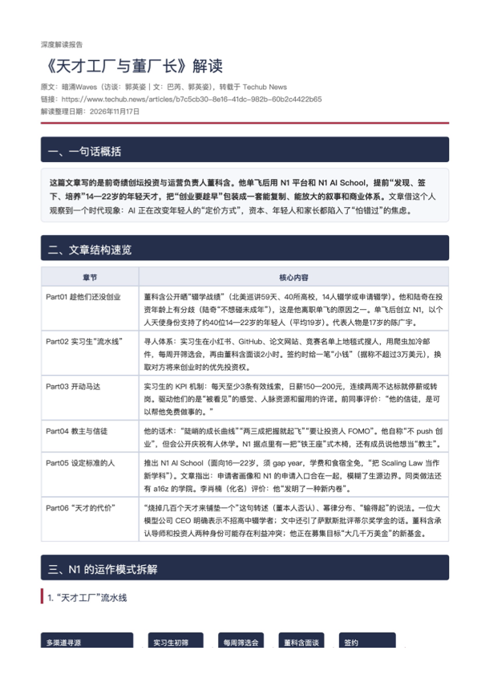
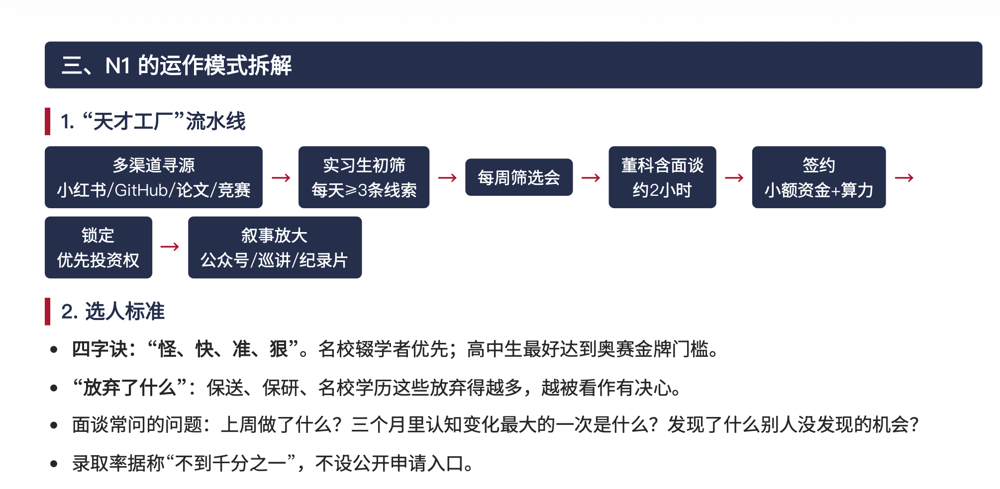

# Kerf

[中文](#中文) · [English](#english)

## 中文

Kerf 是给 Cherry Studio 等 AI 客户端用的本地 PDF 工具，把 Markdown 或 HTML 排成文字可搜索、可复制的 PDF。

### 使用前后

下面是同一份《天才工厂与董厂长》报告。旧版 jsPDF 在页边切开了流程图。Cherry Studio 实测用 Kerf 生成 4 页，流程图和表格都完整。

| 使用前 · jsPDF | 使用后 · Kerf |
| --- | --- |
|  |  |

### 分页原理

把标题、段落、图和表格行想成依次摆好的内容块。Kerf 会试算在不同位置放「隔板」的组合，比较整份文档的页数、留白和拆表代价，再选总代价最低的一组。流程图可以作为一个整体排版。必要时，表格可以在完整的行之间分开，并在续页重复表头。[分页规则与验证](docs/optimal-pagination.md)

### 安装

npm 包名正在确认。发布后，安装 Node.js 22 或更新版本，在 Cherry Studio 的 **设置 → MCP → 添加 → 快速创建** 中选 **STDIO**。启动命令为 `npx -y <包名>`，其中 `npx` 填到命令栏，两个参数各占一行。

现在可从源码使用。macOS 和 Linux 的命令栏填启动脚本 `scripts/kerf-mcp` 的完整路径。Windows 的配置和浏览器镜像设置见安装说明。[中文安装说明](docs/cherry-studio.md)

### 致谢

Kerf 基于 BreakFlow 修改，保留了原项目的 MIT 许可证和版权声明。随包分发的 Kerf Sans SC 源自 Noto Sans SC，采用 SIL Open Font License 1.1。[BreakFlow](https://github.com/mehmetduran932/BreakFlow) · [MIT 许可证](LICENSE) · [字体许可证](packages/playwright/assets/fonts/OFL.txt)

## English

Kerf is a local MCP tool that turns Markdown or HTML into searchable, selectable PDFs for AI clients such as Cherry Studio.

### Before and after

The images above show the same report. A jsPDF page boundary cuts the flowchart. In Cherry Studio, Kerf produced a four-page PDF with the flowchart and tables intact.

### How pagination works

Imagine lining up headings, paragraphs, figures and table rows. Kerf evaluates where to place page dividers across the whole document, charging for pages, blank space and table splits. It chooses the lowest total cost among the allowed layouts. Figures can stay together, and tables that span pages break between whole rows with repeated headers. [Pagination rules and validation](docs/optimal-pagination.md)

### Installation

The npm name is pending. After publication, install Node.js 22 or later and add a STDIO server in **Settings → MCP → Add → Quick Create**. The launch command will be `npx -y <package-name>`. Enter `npx` as the command and the other two values as separate arguments.

For the source build, use the absolute path to `scripts/kerf-mcp` on macOS or Linux. The setup guide also covers Windows and browser downloads. [Setup guide](docs/cherry-studio.md)

### Credits and development

Kerf is based on BreakFlow and retains its MIT license and copyright notice. The bundled Kerf Sans SC font is based on Noto Sans SC and licensed under the SIL Open Font License 1.1. [BreakFlow](https://github.com/mehmetduran932/BreakFlow) · [MIT license](LICENSE) · [Font license](packages/playwright/assets/fonts/OFL.txt)

For development, install with `pnpm install --frozen-lockfile` and `python -m pip install -r scripts/requirements.txt`. Set `KERF_PYTHON` to your Python executable if needed. Install the test browser with `pnpm exec playwright install chromium`. Run `pnpm acceptance` to generate the PDF and page-image comparisons, and `pnpm test` and `pnpm test:mcp` to run the test suites. The gallery compares both algorithms and four table-split costs. [Comparison gallery](docs/comparison/)
