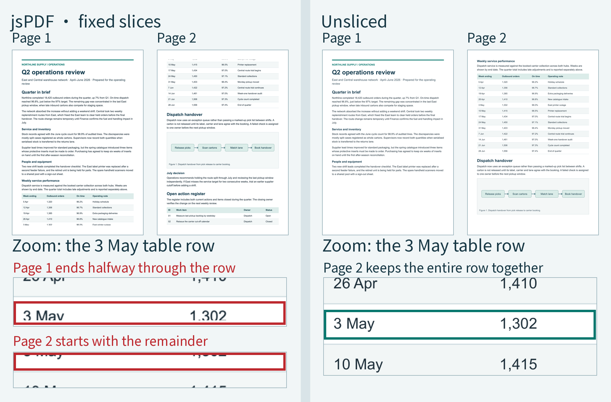
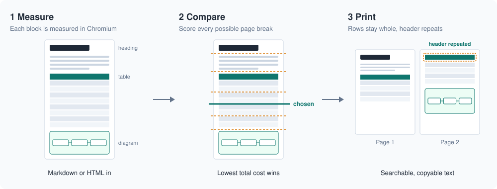
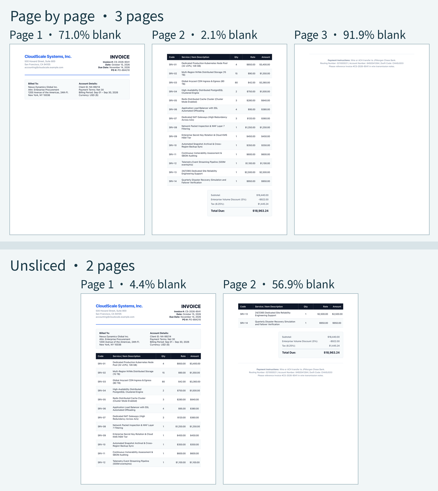

# Unsliced

**Turn Markdown or HTML into searchable PDFs that never slice tables or diagrams in half.**

[](https://www.npmjs.com/package/unsliced-pdf-mcp)
[](https://glama.ai/mcp/servers/harrythex42/Unsliced)
[](LICENSE)

English · [中文](README.zh-CN.md)



Unsliced is a local MCP tool for AI assistants such as Claude, Cursor and OpenCode. It chooses page breaks across the whole document instead of page by page:

- **Tables split only between complete rows**, with the header repeated on continuation pages.
- **Diagrams, cards and images stay whole** whenever they fit on a page, and headings stay with the content that follows.
- **Real text, not screenshots.** You can search and copy everything in the PDF.
- **Chinese works out of the box** with a bundled font.

## Install

Install [Node.js 22 or newer](https://nodejs.org/en/download), then add a local **stdio** MCP server with this launch command:

```sh
npx -y unsliced-pdf-mcp
```

Any MCP client that can launch a local stdio server can use it. No HTTP URL or separate installation from source is required.

<details>
<summary><b>Claude Desktop</b></summary>

Merge into `claude_desktop_config.json` via **Settings → Developer → Edit Config**, then quit and reopen Claude Desktop. [Official documentation](https://modelcontextprotocol.io/docs/develop/connect-local-servers).

```json
{
  "mcpServers": { "unsliced": { "command": "npx", "args": ["-y", "unsliced-pdf-mcp"] } }
}
```

</details>

<details>
<summary><b>Cursor</b></summary>

Merge into `.cursor/mcp.json` (project) or `~/.cursor/mcp.json` (global). [Official documentation](https://cursor.com/docs/context/mcp).

```json
{
  "mcpServers": { "unsliced": { "type": "stdio", "command": "npx", "args": ["-y", "unsliced-pdf-mcp"] } }
}
```

</details>

<details>
<summary><b>OpenCode</b></summary>

Merge into `opencode.jsonc`. [Official documentation](https://opencode.ai/docs/mcp-servers#local).

```json
{
  "$schema": "https://opencode.ai/config.json",
  "mcp": { "servers": { "unsliced": { "type": "local", "command": ["npx", "-y", "unsliced-pdf-mcp"] } } }
}
```

</details>

Ask your assistant to use `create_pdf` and return the saved path. By default, PDF files go to `Documents/Unsliced`. Source archiving is off by default; set `UNSLICED_KEEP_SOURCE=1` to save the unchanged source and its generation record under `sources/` in the PDF output directory. [Setup and troubleshooting](docs/setup.md#english).

## How it works



Each page break has a cost: blank space left at the bottom of a page, an extra page, or a table split. Unsliced adds up the cost of every complete plan and picks the lowest, instead of filling one page at a time.

## Compare pagination

### Fixed-height slices

The image at the top shows the same [fictional Northline quarterly report](samples/northline-quarterly.html) on A4 with 15 mm margins. Fixed-height jsPDF slices cut through the 3 May table row between pages 1 and 2. Unsliced keeps the entire row on page 2.

| jsPDF fixed slices | Unsliced |
| --- | --- |
| 4 pages · 3 cut table rows | 4 pages · 0 cut blocks |

This jsPDF baseline uses raster slices, so its pages are images and the text cannot be searched or copied. It does not represent every jsPDF export mode.

### Page by page vs whole document



A sample service invoice. Planning one page at a time moves the whole table to page 2, leaving page 1 71% blank and pushing the payment note onto a third page. Unsliced splits the table between complete rows and fits the invoice on 2 pages. On ordinary reports, both approaches often choose the same breaks; the difference shows up mainly around long tables.

[Pagination rules](docs/optimal-pagination.md) · [More comparisons](docs/comparison/) · [Local preference review](docs/pagination-review.md)

## Credits and development

Unsliced is based on BreakFlow and retains its MIT license and copyright notice. The bundled Unsliced Sans SC font is based on Noto Sans SC and is licensed under SIL Open Font License 1.1. [BreakFlow](https://github.com/mehmetduran932/BreakFlow) · [MIT license](LICENSE) · [Font license](packages/playwright/assets/fonts/OFL.txt)

Unsliced’s approach belongs to the family of globally optimized pagination methods and draws on the work of Donald Knuth and Michael Plass ([global line breaking, 1981](docs/optimal-pagination.md#related-work)); Michael Plass ([doctoral dissertation on optimal pagination, 1981](docs/optimal-pagination.md#related-work)); Frank Mittelbach ([global pagination framework, 2016](docs/optimal-pagination.md#related-work)); and Brüggemann-Klein et al. ([pagination of complex documents, 2003](docs/optimal-pagination.md#related-work)).

Install dependencies with `pnpm install --frozen-lockfile` and `python -m pip install -r scripts/requirements.txt`. Use `UNSLICED_PYTHON` to select a Python environment if needed. Run `pnpm exec playwright install chromium`, `pnpm test`, `pnpm test:mcp`, and `pnpm acceptance`.
