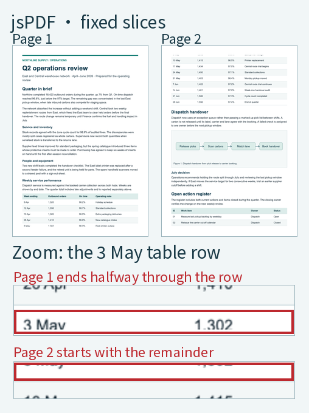
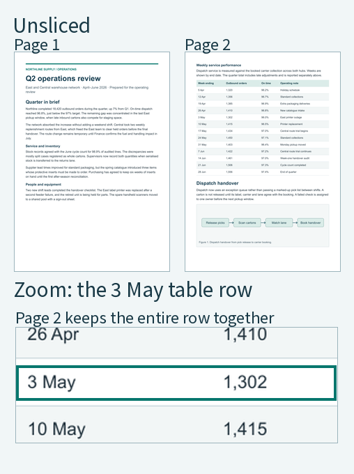

# Unsliced

[English](#english) · [中文](#中文)

## English

Unsliced is a local MCP tool that turns Markdown or HTML into searchable, selectable PDFs. It compares page breaks across the whole document to balance page count, blank space, and table splits. It keeps diagrams together and splits long tables between complete rows, repeating the header on continuation pages.

### Install

Install [Node.js 22 or newer](https://nodejs.org/en/download), then add a local **stdio** MCP server with this launch command:

```sh
npx -y unsliced-pdf-mcp
```

[Version 0.1.1 is published on npm](https://www.npmjs.com/package/unsliced-pdf-mcp/v/0.1.1). Any MCP client that can launch a local stdio server can use it. No HTTP URL or separate installation from source is required.

**OpenCode V2** — merge into `opencode.jsonc`. [Official documentation](https://opencode.ai/docs/mcp-servers#local).

```json
{
  "$schema": "https://opencode.ai/config.json",
  "mcp": { "servers": { "unsliced": { "type": "local", "command": ["npx", "-y", "unsliced-pdf-mcp"] } } }
}
```

**Claude Desktop** — merge into `claude_desktop_config.json` via **Settings → Developer → Edit Config**, then quit and reopen Claude Desktop. [Official documentation](https://modelcontextprotocol.io/docs/develop/connect-local-servers).

```json
{
  "mcpServers": { "unsliced": { "command": "npx", "args": ["-y", "unsliced-pdf-mcp"] } }
}
```

**Cursor** — merge into `.cursor/mcp.json` (project) or `~/.cursor/mcp.json` (global). [Official documentation](https://cursor.com/docs/context/mcp).

```json
{
  "mcpServers": { "unsliced": { "type": "stdio", "command": "npx", "args": ["-y", "unsliced-pdf-mcp"] } }
}
```

Ask your assistant to use `create_pdf` and return the saved path. By default, PDF files go to `Documents/Unsliced`. Source archiving is off by default; set `UNSLICED_KEEP_SOURCE=1` to save the unchanged source and its generation record under `sources/` in the PDF output directory. [Setup and troubleshooting](docs/setup.md#english).

### Compare pagination

The same [fictional Northline quarterly report](samples/northline-quarterly.html), rendered on A4 with 15 mm margins. The red boxes show where fixed-height jsPDF slices cut through the 3 May table row between pages 1 and 2. Unsliced keeps the entire row on page 2. This baseline uses raster slices; it does not represent every jsPDF export mode.

| jsPDF fixed slices | Unsliced |
| --- | --- |
|  |  |
| 4 pages · 3 cut table rows | 4 pages · 0 cut blocks |

In this jsPDF fixed-slice export, the pages are images, so the text cannot be searched or copied. Unsliced produces real, searchable and copyable text.

[Pagination rules](docs/optimal-pagination.md) · [More comparisons](docs/comparison/) · [Local preference review](docs/pagination-review.md)

### Credits and development

Unsliced is based on BreakFlow and retains its MIT license and copyright notice. The bundled Unsliced Sans SC font is based on Noto Sans SC and is licensed under SIL Open Font License 1.1. [BreakFlow](https://github.com/mehmetduran932/BreakFlow) · [MIT license](LICENSE) · [Font license](packages/playwright/assets/fonts/OFL.txt)

Unsliced’s approach belongs to the family of globally optimized pagination methods and draws on the work of Donald Knuth and Michael Plass ([global line breaking, 1981](docs/optimal-pagination.md#related-work)); Michael Plass ([doctoral dissertation on optimal pagination, 1981](docs/optimal-pagination.md#related-work)); Frank Mittelbach ([global pagination framework, 2016](docs/optimal-pagination.md#related-work)); and Brüggemann-Klein et al. ([pagination of complex documents, 2003](docs/optimal-pagination.md#related-work)).

Install dependencies with `pnpm install --frozen-lockfile` and `python -m pip install -r scripts/requirements.txt`. Use `UNSLICED_PYTHON` to select a Python environment if needed. Run `pnpm exec playwright install chromium`, `pnpm test`, `pnpm test:mcp`, and `pnpm acceptance`.

## 中文

Unsliced（分寸）是本地 MCP 工具，把 Markdown 或 HTML 排成文字可搜索、可复制的 PDF。它比较整份文档的分页位置，在页数、留白和拆表之间取舍。流程图可以保持完整；长表格在完整数据行之间分页，并在续页重复表头。

### 安装

安装 [Node.js 22 或更新版本](https://nodejs.org/zh-cn/download)，添加本地 **STDIO** MCP 服务，启动命令为：

```sh
npx -y unsliced-pdf-mcp
```

[0.1.1 版已在 npm 发布](https://www.npmjs.com/package/unsliced-pdf-mcp/v/0.1.1)。任何能启动本地 STDIO 服务的 MCP 客户端都可以使用，不需要 HTTP 地址，也不需要下载源码安装。

**OpenCode V2**：合并到 `opencode.jsonc`。[官方说明](https://opencode.ai/docs/mcp-servers#local)。

```json
{
  "$schema": "https://opencode.ai/config.json",
  "mcp": { "servers": { "unsliced": { "type": "local", "command": ["npx", "-y", "unsliced-pdf-mcp"] } } }
}
```

**Claude Desktop**：通过 **Settings → Developer → Edit Config** 合并到 `claude_desktop_config.json`，然后完全退出并重新打开应用。[官方说明](https://modelcontextprotocol.io/docs/develop/connect-local-servers)。

```json
{
  "mcpServers": { "unsliced": { "command": "npx", "args": ["-y", "unsliced-pdf-mcp"] } }
}
```

**Cursor**：合并到项目 `.cursor/mcp.json` 或全局 `~/.cursor/mcp.json`。[官方说明](https://cursor.com/docs/context/mcp)。

```json
{
  "mcpServers": { "unsliced": { "type": "stdio", "command": "npx", "args": ["-y", "unsliced-pdf-mcp"] } }
}
```

请助手调用 `create_pdf` 并返回保存路径。PDF 默认保存在 `Documents/Unsliced`（文稿 → Unsliced）。默认不保存原稿；设置 `UNSLICED_KEEP_SOURCE=1` 后，会在 PDF 输出目录的 `sources/` 保存原稿和生成记录。[安装详情与问题排查](docs/setup.md#中文)。

### 分页对比

同一份[虚构的 Northline 季度运营报告](samples/northline-quarterly.html)，使用 A4 和 15 毫米页边距。红框放大了第 1、2 页交界处被切成两半的「3 May」表格行；Unsliced 把整行保留在第 2 页。这里的 jsPDF 对照版按固定高度将截图切片，不代表 jsPDF 的所有导出方式。

| jsPDF 固定切片 | Unsliced |
| --- | --- |
|  |  |
| 4 页 · 切开 3 行表格 | 4 页 · 切开 0 块 |

这份 jsPDF 固定切片版的页面是图片，文字不能搜索或复制；Unsliced 生成的是真实文字，可以搜索和复制。

[分页规则](docs/optimal-pagination.md) · [更多对比](docs/comparison/) · [本地偏好评审](docs/pagination-review.md)

### 致谢与开发

Unsliced 基于 BreakFlow，保留其 MIT 许可证和版权声明。随包分发的 Unsliced Sans SC 源自 Noto Sans SC，采用 SIL Open Font License 1.1。[BreakFlow](https://github.com/mehmetduran932/BreakFlow) · [MIT 许可证](LICENSE) · [字体许可证](packages/playwright/assets/fonts/OFL.txt)

Unsliced 的分页方法属于「全局最优分页」这一类，受益于 Donald Knuth 与 Michael Plass 的[全局断行算法（1981）](docs/optimal-pagination.md#related-work)、Michael Plass 的[最优分页博士论文（1981）](docs/optimal-pagination.md#related-work)、Frank Mittelbach 的[全局分页框架（2016）](docs/optimal-pagination.md#related-work)，以及 Brüggemann-Klein 等人对[复杂文档分页的研究（2003）](docs/optimal-pagination.md#related-work)。

使用 `pnpm install --frozen-lockfile` 和 `python -m pip install -r scripts/requirements.txt` 安装依赖。需要时用 `UNSLICED_PYTHON` 指定 Python 环境。运行 `pnpm exec playwright install chromium`、`pnpm test`、`pnpm test:mcp` 和 `pnpm acceptance`。
