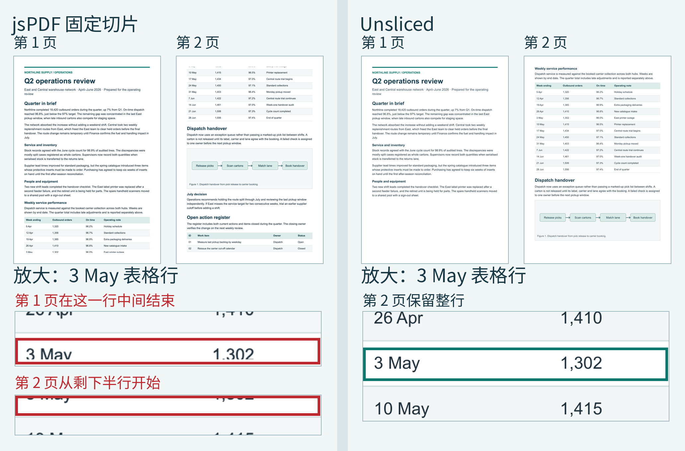
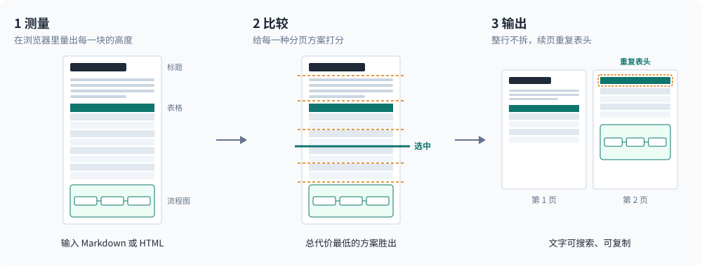
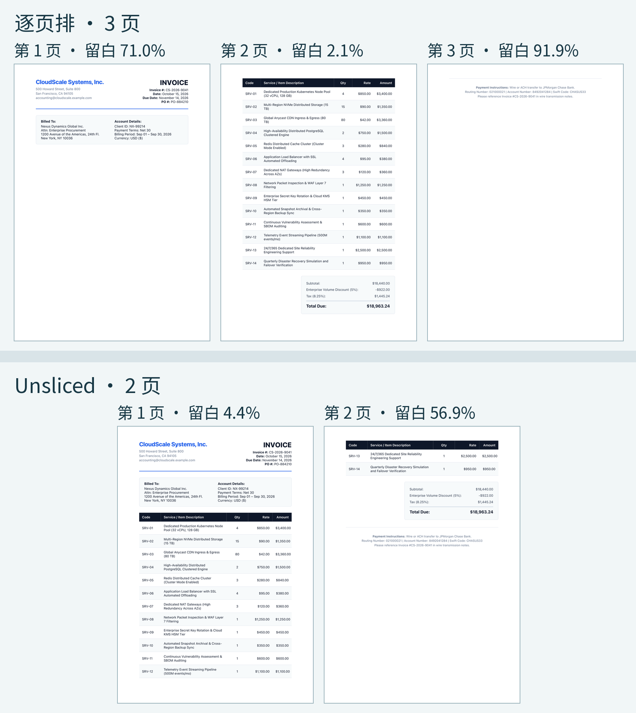

# Unsliced（分寸）

**把 Markdown 或 HTML 排成文字可搜索的 PDF，表格和流程图不会被切成两半。**

**不想安装 MCP？[直接在网页上用 Unsliced](https://harrythex42.github.io/Unsliced/)。** 推荐 Chrome 或 Edge。

[](https://www.npmjs.com/package/unsliced-pdf-mcp)
[](https://glama.ai/mcp/servers/harrythex42/Unsliced)
[](LICENSE)

[English](README.md) · 中文



Unsliced 是本地 MCP 工具，Claude、Cursor、OpenCode 等 AI 助手可以直接调用它生成 PDF。它比较整份文档的分页位置，而不是一页一页往后排：

- **长表格只在完整的行之间分页**，续页自动重复表头。
- **流程图、卡片和图片只要放得下一页就保持完整**，标题跟着后面的内容走。
- **真实文字，不是截图。** PDF 里的内容都能搜索、复制。
- **中文直接可用**，字体随工具一起提供。

## 安装

安装 [Node.js 22 或更新版本](https://nodejs.org/zh-cn/download)，添加本地 **STDIO** MCP 服务，启动命令为：

```sh
npx -y unsliced-pdf-mcp
```

任何能启动本地 STDIO 服务的 MCP 客户端都可以使用，不需要 HTTP 地址，也不需要下载源码安装。

<details>
<summary><b>Claude Desktop</b></summary>

通过 **Settings → Developer → Edit Config** 合并到 `claude_desktop_config.json`，然后完全退出并重新打开应用。[官方说明](https://modelcontextprotocol.io/docs/develop/connect-local-servers)。

```json
{
  "mcpServers": { "unsliced": { "command": "npx", "args": ["-y", "unsliced-pdf-mcp"] } }
}
```

</details>

<details>
<summary><b>Cursor</b></summary>

合并到项目 `.cursor/mcp.json` 或全局 `~/.cursor/mcp.json`。[官方说明](https://cursor.com/docs/context/mcp)。

```json
{
  "mcpServers": { "unsliced": { "type": "stdio", "command": "npx", "args": ["-y", "unsliced-pdf-mcp"] } }
}
```

</details>

<details>
<summary><b>OpenCode</b></summary>

合并到 `opencode.jsonc`。[官方说明](https://opencode.ai/docs/mcp-servers#local)。

```json
{
  "$schema": "https://opencode.ai/config.json",
  "mcp": { "servers": { "unsliced": { "type": "local", "command": ["npx", "-y", "unsliced-pdf-mcp"] } } }
}
```

</details>

请助手调用 `create_pdf` 并返回保存路径。PDF 默认保存在 `Documents/Unsliced`（文稿 → Unsliced）。默认不保存原稿；设置 `UNSLICED_KEEP_SOURCE=1` 后，会在 PDF 输出目录的 `sources/` 保存原稿和生成记录。[安装详情与问题排查](docs/setup.md#中文)。

## 工作原理



每个分页位置都有代价：页底留下的空白、多出来的一页、把表格拆开。Unsliced 把每种完整方案的代价加起来，选总代价最低的，而不是填满一页再排下一页。

## 分页对比

### 固定高度切片

顶部的图是同一份[虚构的 Northline 季度运营报告](samples/northline-quarterly.html)，使用 A4 和 15 毫米页边距。jsPDF 按固定高度切片，把「3 May」表格行切在第 1、2 页之间；Unsliced 把整行保留在第 2 页。

| jsPDF 固定切片 | Unsliced |
| --- | --- |
| 4 页 · 切开 3 行表格 | 4 页 · 切开 0 块 |

这里的 jsPDF 对照版把截图按固定高度切片，页面是图片，文字不能搜索或复制。它不代表 jsPDF 的所有导出方式。

### 逐页排与通盘排



一份样例服务发票。一页一页往后排时，整张表被推到第 2 页，第 1 页空了 71%，付款说明被挤到第 3 页。Unsliced 在完整的行之间拆表，排成 2 页。普通报告上两种方式常常选出同样的分页位置，差别主要出现在长表格附近。

[分页规则](docs/optimal-pagination.md) · [更多对比](docs/comparison/) · [本地偏好评审](docs/pagination-review.md)

## 致谢与开发

Unsliced 基于 BreakFlow，保留其 MIT 许可证和版权声明。随包分发的 Unsliced Sans SC 源自 Noto Sans SC，采用 SIL Open Font License 1.1。[BreakFlow](https://github.com/mehmetduran932/BreakFlow) · [MIT 许可证](LICENSE) · [字体许可证](packages/playwright/assets/fonts/OFL.txt)

Unsliced 的分页方法属于「全局最优分页」这一类，受益于 Donald Knuth 与 Michael Plass 的[全局断行算法（1981）](docs/optimal-pagination.md#related-work)、Michael Plass 的[最优分页博士论文（1981）](docs/optimal-pagination.md#related-work)、Frank Mittelbach 的[全局分页框架（2016）](docs/optimal-pagination.md#related-work)，以及 Brüggemann-Klein 等人对[复杂文档分页的研究（2003）](docs/optimal-pagination.md#related-work)。

使用 `pnpm install --frozen-lockfile` 和 `python -m pip install -r scripts/requirements.txt` 安装依赖。需要时用 `UNSLICED_PYTHON` 指定 Python 环境。运行 `pnpm exec playwright install chromium`、`pnpm test`、`pnpm test:mcp` 和 `pnpm acceptance`。
