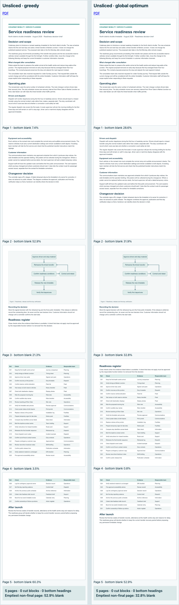

# Optimal pagination

Global optimal pagination is the default for the browser and Playwright. Use `strategy: 'greedy-scored'` to opt into the greedy planner. In the
browser pass `optimal` alongside the strategy. In Playwright put numeric
options in `config.optimal`. Function-valued options run in the browser.
For custom JavaScript in Playwright, use the existing trusted strategy script
option to construct `new BreakFlow.OptimalStrategy(options)` in that browser.

For page height H, reserve 4 CSS pixels by default. Measure a representative
body paragraph's line height L in the print layout. For a page using h pixels,
r = (H − h) / L. The default whitespace function is
min(1,000,000, 1.18 ^ max(0, r − 2) − 1). Every page pays this function at
15 lines, about 7.60 units. Only non-final pages pay it on their remaining
space. The free allowance absorbs small gaps. Exponential growth favors
distributing substantial gaps across pages. The cap bounds very short blocks'
costs even in small type. These parameters are aesthetic choices.

Options include freeLines, growth, cap, fixedLines, reservePx, keepHeadings,
whitespaceCost(lines), and breakPenalty(left, right). The latter defaults to
zero. Infinity forbids that boundary. Costs must be nonnegative. Heading and
keep-with-next boundaries are protected. If protection conflicts with page
height or forced breaks, minimize the number of protections relaxed first.
The report lists each relaxed boundary. Oversized non-table blocks use the original
greedy splitter in isolation. Its fragments form fixed page units; the
optimality claim applies to the given measurable blocks and these fixed units.
An unsplittable object taller than a physical page remains an overflow error
in acceptance.

For each prefix ending at j, try each feasible last-page start i. Add the
last page's cost and the cost of its ending boundary to the best result for
prefix i. Apply the final-page discount only when j is the document end.
Every feasible partition has one such last page, and replacing its prefix by
a better one preserves feasibility. Induction from the empty prefix proves
optimality. Store predecessor indices to reconstruct the chosen pages.
Time is O(nk), where k is the largest number of blocks fitting on a page.
Auxiliary storage is O(n). The exhaustive oracle checks all cut masks for
300 seeded documents. The performance test measures planning on 5,000
already measured blocks and excludes browser layout and PDF export.

Run `pnpm acceptance` to produce both versions. Open
`output/acceptance/report.md` for the metrics and
`output/acceptance/comparison.html` for paired page images.

## Tables

A direct table in the printable flow contributes one unit per data row. A
page interval pays for the header again when it starts inside a table. Each
interior table cut pays `whitespaceCost(tableSplitLines)`. The default of 15
uses the same charge as one extra page. Both costs can be tuned independently.
`minTableRows` defaults to 2 and applies to every partial fragment, including
the final fragment. A whole short table is always legal. Rowspans prohibit
breaks through the spanning cell, including rowSpan=0 within its row group.
A marked keep-together table stays intact if it fits a fresh page. Repeated
headers come from the source thead or leading all-th rows. A source without
column labels has no labels to repeat. Captions and totals appear once.

Candidate-page validity and height depend only on the starting and ending
unit. This preserves the prefix optimality proof. Compare candidates first
by the number of short fragments in oversized tables, then by relaxed
keep-with-next boundaries, then by total numeric cost. A short fragment of a
table that fits a fresh page is forbidden. A heading, immediately preceding
paragraph or marked introduction stays with the start of its table. If one
indivisible row (or rowspan group) plus the header is taller than a page,
the planner reports that no legal layout exists. It never clips that row.

The table oracle independently enumerates every cut mask of 350 small random
documents with two tables, varying headers, row heights, split charges and
minimum row counts. Acceptance compares the printed data cells to the input
in source order and verifies each repeated header at the exact beginning of
its PDF page. It deliberately removes a header and moves half a data row to
the next page, then restores the rendered nodes.

## Greedy vs. global optimum

**Why US Letter?** We show [Cedarway's service readiness report](../samples/cedarway-readiness-report.html) on US Letter because the same report exposes a difference in break choices at that paper size. Both strategies received the same source and 15 mm margins. On A4, both strategies produced four pages with identical page images; the emptiest non-final page had 11.2% blank space in both. Four of the five fictional reports in the comparison set showed identical or nearly identical results with greedy and global pagination under the tested settings. This example shows when global planning can help, not how often it wins.

| US Letter | Greedy | Global optimum |
| --- | --- | --- |
| PDF pages | 5 | 5 |
| Cut blocks / headings stranded at the bottom | 0 / 0 | 0 / 0 |
| Blank space on the emptiest non-final page | 52.9% (page 2) | 32.8% (page 3) |

Blank space is measured at the bottom of the rendered PDF within the 15 mm margins. The last page is always excluded from the maximum. Reproduce the Letter run with `pnpm acceptance --letter-demo`.

**为什么用 US Letter？** 同一份 [Cedarway 新班次上线报告](../samples/cedarway-readiness-report.html) 用 Letter 排版时，两种算法的断点和留白差别比较清楚。两版用同一原稿和 15 毫米页边距。换成 A4 后，两版都是 4 页，逐页图片完全相同；不计末页，最空一页的留白都是 11.2%。按这次比较的设置，5 份候选报告中有 4 份的贪心和全局最优结果相同或几乎相同。Cedarway 展示的是全局规划**什么时候**有帮助，不代表它通常会胜出。

Letter 两版均为 5 页，没有意外切块或页底孤立标题。不计末页，贪心版最空一页留白 52.9%（第 2 页），全局最优版为 32.8%（第 3 页）。数字以实际 PDF 的页底留白为准，不含页边距。

## Related work

- Donald E. Knuth and Michael F. Plass, [*Breaking Paragraphs into Lines*](https://doi.org/10.1002/spe.4380111102), *Software: Practice and Experience* (1981). Uses dynamic programming to choose line breaks across a whole paragraph, instead of deciding line by line.
- Michael F. Plass, [*Optimal Pagination Techniques for Automatic Typesetting Systems*](https://searchworks.stanford.edu/view/1013335), Stanford PhD dissertation (1981; [full text](https://tug.org/docs/plass/plass-thesis.pdf)). Uses a cost function and dynamic programming to place text and figures on pages.
- Frank Mittelbach, [*A General Framework for Globally Optimized Pagination*](https://doi.org/10.1145/2960811.2960820), ACM DocEng (2016), and the [extended journal article of the same title](https://doi.org/10.1111/coin.12165), *Computational Intelligence* 35(2) (2019 issue; first published online in 2018). Presents a global page-breaking framework for TeX and explores the flexibility of paragraph lengths.
- Anne Brüggemann-Klein, Rolf Klein, and Stefan Wohlfeil, [*On the Pagination of Complex Documents*](https://doi.org/10.1007/3-540-36477-3_5), in *Computer Science in Perspective* (2003). Optimizes the number of page turns needed to read text and find its referenced floating objects.

Unsliced belongs to this family of methods. Here the input is typically AI-generated Markdown or HTML: Unsliced measures the rendered blocks in a browser and then optimizes page breaks under its own layout constraints. It does not claim to invent globally optimized pagination.

### 相关研究

- Donald E. Knuth 与 Michael F. Plass：[《Breaking Paragraphs into Lines》](https://doi.org/10.1002/spe.4380111102)，*Software: Practice and Experience*（1981）。用动态规划为整段文字选择断行，不逐行单独决定。
- Michael F. Plass：[《Optimal Pagination Techniques for Automatic Typesetting Systems》](https://searchworks.stanford.edu/view/1013335)，斯坦福大学博士论文（1981，[全文](https://tug.org/docs/plass/plass-thesis.pdf)）。用代价函数和动态规划把文字和图安排到不同页面。
- Frank Mittelbach：[《A General Framework for Globally Optimized Pagination》](https://doi.org/10.1145/2960811.2960820)，ACM DocEng（2016），以及同题的[期刊扩展版](https://doi.org/10.1111/coin.12165)，*Computational Intelligence* 35(2)（2019 年刊期，2018 年先在线发表）。为 TeX 提出全局分页框架，并研究如何利用段落行数可调整的空间。
- Anne Brüggemann-Klein、Rolf Klein 与 Stefan Wohlfeil：[《On the Pagination of Complex Documents》](https://doi.org/10.1007/3-540-36477-3_5)，收录于 *Computer Science in Perspective*（2003）。用读正文和查找相关浮动对象所需的翻页次数来衡量和优化分页。

Unsliced 属于这类方法，不是全局最优分页的首创。区别是它面向 AI 生成的 Markdown 或 HTML：先在浏览器里测量排好的内容块，再按自身的排版规则选择整份文档的分页位置。
